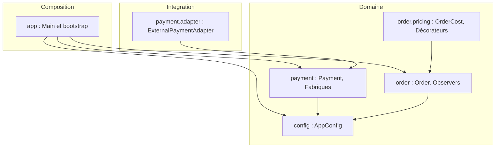

# TEST DE COMPÉTENCES

## JAVA DESIGN PATTERNS

* **Niveau :** Master 1 Développement logiciel
* **Durée :** 2 h 30
* **Note :** /20
* **Nom et prénom :** Clément Droual
* **Date :** 19/10/2026

**Consignes :** Travail individuel. Java 17 ou supérieur. Justifiez les choix de conception, utilisez des interfaces et fournissez du code compilable. Les diagrammes UML sont facultatifs sauf indication contraire.

---

## Partie 1 — Compréhension et analyse (5 points)

### Exercice 1 — Identifier le pattern (3 points)

Pour chacune des six situations suivantes, identifiez le design pattern approprié et justifiez votre choix en une ou deux phrases.

1. Une application doit partager une seule instance de son gestionnaire de configuration.

* **Singleton** : garantit une instance unique et un accès global, évitant les incohérences d'état.

2. Un système de paiement doit intégrer une API externe dont l'interface est incompatible.

* **Adapter** : convertit l'interface externe vers le contrat attendu par l'application sans modifier le code tiers.

3. Une application doit ajouter dynamiquement compression et chiffrement à un flux.

* **Decorator** : empile des fonctionnalités à l'exécution autour d'un flux de base sans multiplier les sous-classes.

4. Plusieurs composants doivent être informés lorsqu'une commande change de statut.

* **Observer** : notifie automatiquement une liste d'abonnés dès que l'état du sujet change, en découplant l'émetteur des récepteurs.

5. Une application doit créer différents types de notifications sans dépendre des classes concrètes.

* **Factory Method** : délègue l'instanciation concrète à des fabriques dédiées ; le client ne manipule que l'interface `Notification`.

6. Une application doit créer des familles cohérentes de composants graphiques Windows et macOS.

* **Abstract Factory** : fournit une interface pour instancier des familles d'objets compatibles entre eux sans lier le code aux implémentations graphiques.

### Exercice 2 — Questions de réflexion (2 points)

1. Quelle différence existe-t-il entre Factory Method et Singleton ?

* **Factory Method** gère *le type à créer* sans coupler le client (nombre d'instances libre). **Singleton** gère *la cardinalité* (strictement une instance globale). Une fabrique peut d'ailleurs être un Singleton.

2. Pourquoi privilégier Decorator plutôt que multiplier les sous-classes ?

* L'héritage statique provoque une explosion combinatoire ($2^N$ sous-classes pour $N$ options cumulables). Decorator résout cela par composition dynamique : une classe par option, empilable à la demande sans toucher à la classe de base.

3. Quelle différence existe-t-il entre Adapter et Decorator ?

* **Adapter** adapte une interface incompatible pour la rendre utilisable par le client (changement de contrat). **Decorator** conserve l'interface initiale et lui ajoute des responsabilités à l'exécution.

4. Quels risques présente Singleton dans une application multithread ?

* Instanciation concurrente en double accès sans verrou adéquat, goulot d'étranglement sur un `getInstance()` synchronisé, et risque de corruption d'état si l'instance globale partagée est mutable.

---

## Partie 2 — Étude de cas Java : Smart E-Commerce Platform (12 points)

Concevez une plateforme e-commerce modulaire intégrant cinq patterns : Factory Method, Singleton, Adapter, Decorator et Observer. Organisez votre solution en classes et interfaces distinctes.

### Task 1 — Factory Method (2,5 points)

La plateforme prend en charge les paiements par carte bancaire et PayPal. Définissez une interface `Payment` avec `pay(double amount)`, puis `CardPayment` et `PayPalPayment`. Créez une classe abstraite `PaymentFactory` déclarant `createPayment()`, puis des fabriques concrètes. Le client doit pouvoir effectuer un paiement sans instancier directement les classes concrètes.

**`src/com/ecommerce/payment/FactoryMethodDemo.java`**

```java
package com.ecommerce.payment;

public class FactoryMethodDemo {

    public static void main(String[] args) {
        PaymentService cardService = new PaymentService(new CardPaymentFactory());
        PaymentService paypalService = new PaymentService(new PayPalPaymentFactory());

        cardService.checkout(149.99);
        paypalService.checkout(89.50);
    }
}

```

```text
Paiement par carte bancaire : 149,99 EUR
Paiement PayPal : 89,50 EUR

```

### Task 2 — Singleton (2 points)

Implémentez `AppConfig` avec constructeur privé, méthode `getInstance()` et propriété `currency` initialisée à « EUR ». L'implémentation doit être thread-safe. Écrivez un test vérifiant que deux appels retournent la même instance.

**`src/com/ecommerce/config/AppConfigTest.java`**

```java
package com.ecommerce.config;

public class AppConfigTest {

    public static void main(String[] args) {
        AppConfig first = AppConfig.getInstance();
        AppConfig second = AppConfig.getInstance();

        if (first != second) {
            throw new AssertionError("getInstance() doit retourner la même instance");
        }

        if (!"EUR".equals(first.getCurrency())) {
            throw new AssertionError("La devise doit être EUR");
        }

        System.out.println("Même instance : " + (first == second));
        System.out.println("Devise : " + first.getCurrency());
    }
}

```

```text
Même instance : true
Devise : EUR

```

### Task 3 — Adapter (2,5 points)

Le système doit intégrer le service tiers suivant sans modifier sa classe :

```java
class ExternalPaymentGateway {
    public void makeTransaction(double amount) {
        System.out.println("External payment: " + amount);
    }
}

```

Implémentez `ExternalPaymentAdapter` pour rendre ce service compatible avec l'interface `Payment`. Expliquez en quoi l'Adapter favorise le principe Open/Closed.

**`src/com/ecommerce/payment/adapter/AdapterDemo.java`**

```java
package com.ecommerce.payment.adapter;

import com.ecommerce.payment.Payment;

public class AdapterDemo {

    public static void main(String[] args) {
        ExternalPaymentGateway gateway = new ExternalPaymentGateway();
        Payment payment = new ExternalPaymentAdapter(gateway);
        payment.pay(250.00);
    }
}

```

```text
External payment: 250.0

```

### Task 4 — Decorator (2,5 points)

Définissez `OrderCost` avec `double getCost()`, `BasicOrder` (100 EUR), `GiftWrappingDecorator` (+5 EUR) et `ExpressDeliveryDecorator` (+15 EUR). Les options doivent pouvoir être combinées sans modifier `BasicOrder`.

```text
Basic Order: 100.0 EUR
With Gift Wrapping: 105.0 EUR
With Gift Wrapping Express Delivery: 120.0 EUR

```

**`src/com/ecommerce/order/DecoratorDemo.java`**

```java
package com.ecommerce.order;

public class DecoratorDemo {

    public static void main(String[] args) {
        OrderCost basic = new BasicOrder();
        OrderCost wrapped = new GiftWrappingDecorator(new BasicOrder());
        OrderCost wrappedExpress = new ExpressDeliveryDecorator(new GiftWrappingDecorator(new BasicOrder()));

        System.out.println("Basic Order: " + basic.getCost() + " EUR");
        System.out.println("With Gift Wrapping: " + wrapped.getCost() + " EUR");
        System.out.println("With Gift Wrapping Express Delivery: " + wrappedExpress.getCost() + " EUR");
    }
}

```

### Task 5 — Observer (2,5 points)

Lorsqu'une commande change de statut, les observateurs sont avertis. Implémentez `Order` (Subject), l'interface `OrderObserver`, `CustomerNotifier` et `InventoryUpdater`. Prévoyez l'inscription et la désinscription des observateurs.

```text
Order status changed: SHIPPED
Customer notified: SHIPPED
Inventory system notified: SHIPPED

```

**`src/com/ecommerce/order/OrderObserverDemo.java`**

```java
package com.ecommerce.order;

public class OrderObserverDemo {

    public static void main(String[] args) {
        Order order = new Order();
        OrderObserver customer = new CustomerNotifier();
        OrderObserver inventory = new InventoryUpdater();

        order.attach(customer);
        order.attach(inventory);

        order.changeStatus(OrderStatus.SHIPPED);

        order.detach(customer);
        order.changeStatus(OrderStatus.DELIVERED);
    }
}

```

---

## Partie 3 — Architecture et qualité logicielle (3 points)

1. **(1 pt)** Un développeur place tous les traitements dans une classe `OrderManager` de 800 lignes. Identifiez deux principes SOLID potentiellement violés et justifiez.

* **SRP (Single Responsibility Principle) :** La classe cumule calcul de prix, persistance, notifications et paiements. Elle a trop de raisons distinctes d'être modifiée.
* **OCP (Open/Closed Principle) :** Tout nouveau moyen de paiement ou canal de notification oblige à modifier le code existant (via des `if`/`switch`) au lieu d'ajouter de nouvelles classes.
* *(DIP en complément)* : La classe référence directement des types concrets au lieu de dépendre d'abstractions injectables.

2. **(1 pt)** Proposez une architecture en packages Java séparant les responsabilités.



* **Découpage métier :** Packages organisés par domaine (`payment`, `order`, `config`), sans dépendances circulaires.
* **Point d'entrée unique :** `app` assemble l'application ; aucun package métier ne pointe vers lui.
* **Isolation :** `payment.adapter` protège le domaine métier contre les dépendances externes.

3. **(1 pt)** Expliquez comment tester indépendamment les paiements, décorateurs et notifications avec JUnit 5.

* **Paiements :** Vérifier que la fabrique retourne le bon type concret avec `assertInstanceOf()`. Pour `PaymentService`, injecter un mock de `Payment` pour tester la délégation sans dépendance réseau.
* **Décorateurs :** Isoler chaque décorateur sur un stub `OrderCost` (`() -> 100.0`) et valider le surcoût avec `assertEquals(5.0, wrapped.getCost() - 100.0)`. Tester ensuite la chaîne complète assemblée.
* **Notifications :** Remplacer les observateurs réels par un espion en mémoire (`List<OrderStatus> events = new ArrayList<>(); order.attach(events::add);`) pour vérifier les réceptions d'événements et les désinscriptions sans analyser la console.
* **Isolation d'exécution :** Les tests restent indépendants car `AppConfig` est immuable, garantissant l'absence d'effets de bord partagés.

---

## Barème

| Élément évalué | Points |
| --- | --- |
| Compréhension et analyse | 5 |
| Factory Method | 2,5 |
| Singleton | 2 |
| Adapter | 2,5 |
| Decorator | 2,5 |
| Observer | 2,5 |
| Architecture et SOLID | 3 |
| **TOTAL** | **20** |

**Critères :** pertinence des patterns, qualité des abstractions, code compilable, tests, principes SOLID et lisibilité.